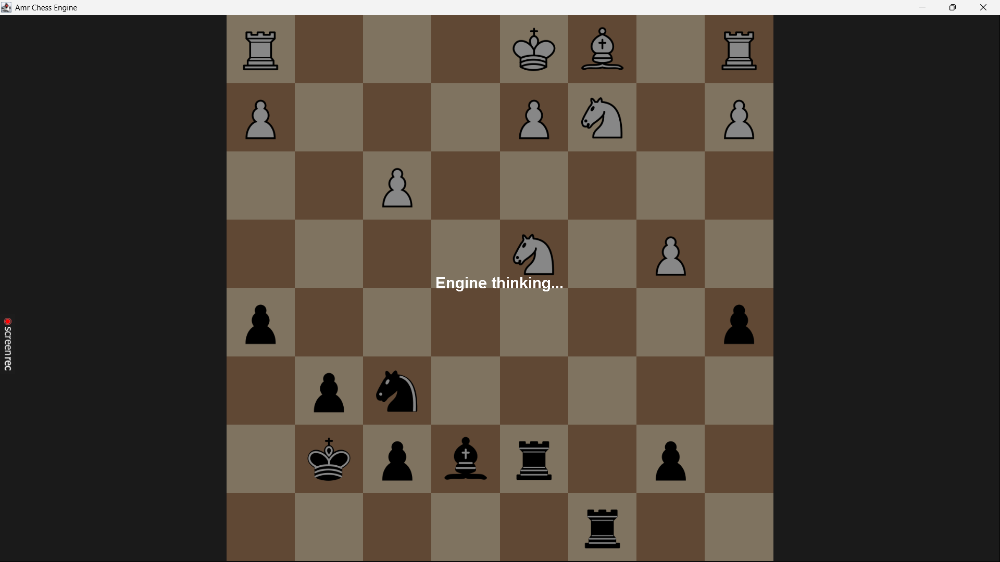

# AnkaJ Chess



A chess engine with a graphical interface, written in Java 21. Originally written years ago,
now refactored with a modern project structure, proper types, and a responsive Swing GUI.

## Features

- **Legal move generation** — all pieces, pawn promotion, check / checkmate / stalemate detection
- **Negamax search** with alpha-beta pruning at depth 4
- **Move ordering** — promotions first, then the most promising moves by shallow evaluation
- **Positional evaluation** — material, mobility, center control, bishop pair bonus,
  and piece values that shift with pawn count (knights worse, rooks better in endgames)
- **Responsive Swing GUI** — drag-and-drop moves, dynamic board sizing, engine search
  runs on a background thread so the interface never freezes

## Requirements

- JDK 21 or newer (tested with Eclipse Temurin 21)
- Maven 3.9+

## Running

Clone and run with Maven:

```bash
git clone https://github.com/YOUR_USERNAME/ankaj-chess.git
cd ankaj-chess
mvn clean compile exec:java
```

Or run the executable JAR (see [Releases](../../releases)):

```bash
java -jar ankaj-chess.jar
```

## How to Play

1. Start the game and choose your color in the dialog
2. Click a piece, then click its destination square
3. The engine thinks in the background and replies — search speed is printed to the console

## Architecture

The engine uses a **flip-board convention**: after every half-move the board is rotated 180°
and piece colors are swapped, so the side to move is always "white" (uppercase). This means
move generation and king-safety logic only need to handle one color.

| File | Responsibility |
| --- | --- |
| `model/Board.java` | Board state (`char[8][8]`), make/undo move, flip, copy constructor |
| `model/Move.java` | Immutable move record (from, to, captured piece, promotion) |
| `engine/MoveGenerator.java` | Generates all legal moves for the side to move |
| `engine/GameLogic.java` | King safety (attack detection) and move legality via make-check-unmake |
| `engine/Evaluation.java` | Material + positional scoring from the side to move's perspective |
| `engine/AlphaBeta.java` | Negamax search with alpha-beta pruning and move ordering |
| `ui/UserInterface.java` | Swing rendering, input handling, background search thread |
| `Main.java` | Entry point, window setup, color selection |

### Design notes

- **No global state** — everything is instance-based, so the GUI and the search each work
  on their own `Board` object (avoids threading issues)
- **Legality by simulation** — a move is legal if making it leaves the mover's king safe;
  the move is made, tested, and unmade
- **Display decoupled from data** — the GUI renders from the player's perspective
  regardless of the board's internal flip state

## Limitations

- No castling or en passant (promotions always to queen)
- Fixed search depth (4 plies)
- No transposition table, opening book, or UCI protocol

```
